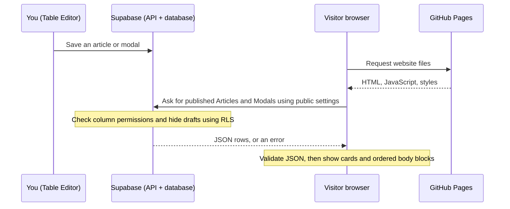

# JSON CMS: setup, editing, and how it works

**Current editing workflow:** use `/admin` to create categories and save draft or published Articles/Modals directly. See [Admin saving and publishing](ADMIN.md#save-publish-and-reopen). The setup walkthrough below also documents the original CMS rollout; the latest admin publishing migration extends its fixed categories and read-only browser permissions. Use `supabase/tests/admin-publishing-security.sql` for the current live security check.

## What this change does

Previously, the website stored project descriptions and lists of images directly inside React page files. A modal always displayed its description first, then all its images, then its videos. LongMarch was a separate page containing hardcoded paragraphs and media.

Now Supabase's **Articles** and **Modals** tables hold that content. Both use the same ordered JSON `body` format. The website renders blocks in array order: paragraph, image, another paragraph, another image, and so on. The existing 12 modals and LongMarch article are captured in `supabase/seed.json` for a one-time import. That file is a migration backup; the public website never imports it and never uses it as a fallback database.

The username-protected **Admin** editor at `/admin` can save draft or published articles/modals and create categories. See [Admin setup and usage](ADMIN.md). Supabase's **Table Editor** remains an owner fallback. There is no website signup flow. Public visitors can read published content; active admins can also read drafts and save changes.

Existing page layouts, categories, typography, media, and the `/LongMarch` address are retained. The home page's featured project and the LongMarch project card now also read their content from the database. Loading/error messages appear while data is loading or if it cannot be read. Content is fetched after the page opens, so there can be a short loading delay; search engines that do not execute JavaScript will only see the static shell. This is the tradeoff for live content updates on GitHub Pages.

## Start here: no database or networking experience needed

A **CMS** (content management system) keeps content separate from page code. Here, you write content in Admin (or Supabase's Table Editor), and the website turns it into cards, articles, and dialogs. You do not need to edit React code to publish another article in an existing category.

### The pieces in everyday terms

| Term | Meaning in this website |
| --- | --- |
| Database / PostgreSQL | Supabase's organized storage for the content. PostgreSQL is the database software. |
| Table, row, column | A table resembles a spreadsheet. One row is one project; columns are its named fields, such as `title` and `published`. `Articles` and `Modals` are separate tables. |
| Article / modal | An article opens a full page with its own link. A modal opens a dialog over a project grid. Both store their text and media in the same JSON format. |
| Slug | A stable name used to find a row, such as `my-new-project`. It is different from the display title and the internal numeric `id`. |
| JSON | Structured text using named fields in `{}` and ordered lists in `[]`. The `content` column stores a JSON object; its `body` is a list of blocks. |
| Browser / client | The visitor's browser runs the website's JavaScript. Admin has a separate authenticated session for authorized editing. |
| Server / host | A computer/service answering requests. GitHub Pages sends website files; Supabase sends published content. They are separate services. |
| API / REST / HTTP request | The API is Supabase's web interface for data. The browser sends an HTTPS request asking for rows, and receives a JSON response. REST describes the style of this interface. HTTP GET reads data. |
| URL / path / query parameter | A URL is an address. In `/articles?slug=my-new-project`, `/articles` chooses the page and `slug=my-new-project` tells that page which row to display. |
| Publishable key | Public configuration identifying API access to the Supabase project. Visitors can see it; it does not give them owner powers. |
| Grant / role / RLS | A role is a set of database permissions. Grants allow operations/columns; row-level security (RLS) limits which rows a role can access. The database enforces these rules, even for requests made outside this website. |
| Build / static export / deploy | Building turns source code into files in `out/`. Static means GitHub Pages serves those files without running a Next.js application server. Deploying uploads a build to the public website. |
| Environment variable | A named configuration setting read by a program. Local settings live in `.env.local`; GitHub build settings live in Actions Variables. These are separate copies. |
| Migration / seed | A migration changes table structure and permission rules. A seed is an initial content import. Neither is a live content backup that should be replayed after editing. |

### What happens when someone opens a page



The browser first shows a static page shell and a loading message. `useCatalog` starts the read after the page mounts (appears in the browser). `catalog.ts` requests both tables, taking up to 500 rows at a time. It checks each row using `content.ts`, then React updates the screen with the result. If a request or validation fails, the page offers **Try again**. It does not substitute the old seed content.

**The important consequence:** GitHub Pages stores the layout/code, while Supabase stores current content. After this branch is deployed, changing a published row changes what a new page load reads. You do not redeploy for text edits or different image URLs. An already open page does not automatically refresh: reload or navigate away and back. The website does not maintain a live subscription to database edits.

### Publish another article, in practice

Follow [Add or edit an article](#add-or-edit-an-article) for the full fields and JSON example. For a new row with `slug = my-new-project` and `published = true`, the deployed address is:

```text
https://maxlee2006.github.io/articles?slug=my-new-project
```

It also appears in `/articles` and the grid matching its `page`/`category`. A new modal appears in its matching grid and opens when its card is clicked; it does not get an article link. Both rows need valid placement fields, a thumbnail, and a body array. A row that is a draft (`published = false`) cannot be previewed through this public website. A malformed published row can make the shared catalog fail validation, so review JSON carefully and run `npm run cms:check` after publishing changes.

Keep existing slugs stable to preserve links. LongMarch is a special compatibility link: the `long-march` article opens at `/LongMarch`. New articles use the query-based address above. GitHub Pages can serve one `/articles` shell for any slug, which is why adding content does not require generating another page file.

### Know which changes require deployment

| Change | What to do |
| --- | --- |
| Edit text, title, order, placement within an existing category, or image URLs | Save the row in Supabase; reload the website. |
| Add a valid article/modal | Save it from Admin; check Published when ready, then reload. |
| Add an image file under repository `public/assets` | Commit and deploy the file; use its `/assets/...` path in content. |
| Use an uploaded image at a public HTTPS Storage URL | Save that URL in content; no website deployment for the URL change. Storage access must be configured separately. |
| Add a category | Use Create category in Admin; the new section appears on its selected page after reload. |
| Change layouts or support another embed provider | Change code, validate, then deploy. |
| Change either public Supabase configuration setting | Update local settings or GitHub Actions Variables as appropriate; rebuild/redeploy the public site so browser JavaScript gets the new values. |

### Public access versus owner access

The public URL tells the client **where** to send requests. The publishable key is intended to travel with those requests. It is not the password you use to sign into the Supabase dashboard. The database still allows visitors to read only the seven CMS columns of published rows, and denies changes. Hiding an edit button or adding a browser-side filter would not enforce security: someone can construct their own requests.

Your Supabase dashboard session has owner editing privileges. Keep that access separate. Never put a database password, service-role key, secret API key, or personal access token into `.env.example`, content JSON, browser code, or `NEXT_PUBLIC_` settings. Also, publishing content makes it public: switching it back to a draft stops future public reads but cannot erase copies someone already downloaded.

### Local preview and the deployed site

Use Node 24. On your computer, check out this branch, run `npm ci`, copy `.env.example` to `.env.local` only if that local file does not exist, then run `npm run dev` and open `http://localhost:3000`. Local preview reads the **same live published content** as the deployed site; it does not create a separate database. Editing local code changes only your preview until you deploy it.

The workflow in `.github/workflows/deploy.yml` deploys on pushes to `main`. A feature-branch push saves work without deploying. When deployment is separately authorized, confirm the public Actions Variables, review/merge the branch into `main`, and watch **Deploy to GitHub Pages** in Actions. In repository **Settings → Pages**, the source should be **GitHub Actions**. The workflow checks content before building and deploying. It never runs the database migration or seed import.

On Windows, `EPERM ... unlink ... next-swc...node` during `npm ci` usually means a development server still has Next.js's native compiler file open. Stop the server with Ctrl+C before installing; close the related Node process if necessary. Restarting Windows releases lingering locks. If a mapped/network drive keeps causing errors, try a checkout on a local drive. Administrator mode is not normally needed.

## Reading the code: a guided path

Start with the files below in order. Comments explain the decisions near the code; this section connects them. A React **component** produces part of the screen. A **hook** such as `useCatalog` connects reusable behavior to React's updates. A **Promise** represents a result that will arrive later, such as a network response.

1. **`utils/supabase/client.ts`: choose the connection settings.** `createClient()` reuses one configured library client. This is not a direct database connection or a permanent cache of content. Next.js embeds the two `NEXT_PUBLIC_` values into browser JavaScript at build time. Login-session features are disabled because the website has no visitor sign-in.
2. **`lib/cms/catalog.ts`: request the data.** `.from()` chooses a table; `.select()` chooses columns; `.eq()` filters to published rows; `.order()` sorts; `.range()` requests a batch. `await` waits for a response without freezing the screen. Each request has a 15-second timeout. Both tables load together; concurrent callers share an in-progress Promise, which is cleared after success or failure. Later reads can get fresh content.
3. **`lib/cms/content.ts`: check what came back.** TypeScript helps while coding but cannot guarantee that live JSON is valid. Zod runs checks on actual values. `recordSchema` checks rows and page/category combinations; block validators check the body. URL validators reject unsafe address forms and restrict embed providers. A valid URL still might point to a missing file.
4. **`lib/cms/useCatalog.ts`: update the screen.** `catalog = null` means data isn't available yet; `error` explains a failed read. An empty list in a loaded catalog is different: the read succeeded but found no rows in that table. Clicking retry changes a counter to run the loading effect again. Cleanup ignores late responses if the visitor leaves; it does not cancel a request another component may be sharing.
5. **Page files: choose what to display.** Portfolio/design/professional pages select categories through `CmsGrid`; the home page selects the first featured article. `pages/articles.tsx` chooses list versus detail using the address's `slug`. `pages/LongMarch.tsx` preserves the old address. They handle loading/errors before passing valid data to display components.
6. **Display components: turn data into HTML.** `CmsGrid` combines tables and sorts cards; `GridItem` links to articles or opens modals. `ArticleView` supplies the full-page layout. `MediaModal` manages the dialog, Escape key, keyboard focus, and scroll restoration. `ContentBody` walks the body array in order; a `group` renders another body within it. Text is escaped by React, not interpreted as HTML. Iframes show allowed external embeds in a restricted browser area.
7. **Maintenance scripts and SQL: manage setup/checks separately.** `check-cms.ts` reads the live public API and validates results; failure exits with an error code so CI stops. `export-seed.ts` only prints SQL text, which an owner can separately run. The migration defines fields and permissions. The seed skips matching slugs instead of overwriting edits. The security SQL temporarily checks visitor roles and rolls back its fixtures.

### What each check tells you

| Command/check | What a pass means | What it does not prove |
| --- | --- | --- |
| `npm run lint` | Code meets the configured lint rules. | Live data access or correct content. |
| `npm test` | Validators/import logic and permissions work in the tested disposable local database. | Production has the same schema/settings. |
| `npm run cms:check` | The current public settings can read live published rows, their JSON validates, both tables are nonempty, and `long-march` exists. Counts can grow beyond the original 1/12. | Visitor writes are denied, media URLs work, or every layout looks right. |
| `npm run build` | Code compiles, types check, and static files export. | Browser reads succeed after deployment; articles are not fetched during this build. |
| `npm run test:e2e` | Browser interactions/rendering pass with mocked Supabase responses. | Live network connectivity or production permissions. |
| Owner-run `supabase/tests/cms-security.sql` | Live database privilege, draft visibility, and denied write-planning assertions pass for both visitor roles. | Every external image/embed loads or a future permission change stays safe. |

For a failure, identify the layer: no response usually points to connectivity; HTTP 403 may come from the cloud proxy **or** remote permissions, so read its message; missing-column errors point to schema; invalid-record errors point to saved JSON; missing images can be separate file/host failures. A GitHub Actions variable read denial is about GitHub integration permissions and says nothing about Supabase content access. The verification history below records the actual completed checks and remaining limitation.

## Before merging or deploying

**Live database setup completed October 20, 2026** for project `vvgaalfwstwpbzzbkbtx`: the adapted migration is applied, LongMarch and all 12 modals are imported, and live PostgreSQL security checks pass. The steps below remain the repeatable setup procedure; do not re-import to replace owner edits. Website deployment and merging remain separate, unperformed actions. The public-key REST check now passes; see the verification section at the end for the remaining GitHub Actions variable access check.

The branch does not automatically change your live database. A public publishable key cannot administer tables. **Apply the schema and import before deploying this branch**; otherwise the site will display a content-unavailable message. The deployment workflow checks readable content and stops on a missing schema, invalid JSON, or missing LongMarch article.

1. In Supabase, open your project and back up/export the existing Articles and Modals tables. The table names are case-sensitive: `"Articles"` and `"Modals"`.
2. Inspect the columns in Table Editor or SQL Editor. Run this read-only SQL to get their definitions:

   ```sql
   select table_name, column_name, data_type, is_nullable, column_default
   from information_schema.columns
   where table_schema = 'public' and table_name in ('Articles', 'Modals')
   order by table_name, ordinal_position;
   ```

3. Open `supabase/migrations/202610200001_cms.sql`. Review it, then paste it into Supabase **SQL Editor** and run it as the database owner. It adds missing CMS columns, a unique slug index, validation checks, public read grants, and row-level security policies. It does not delete existing rows or overwrite existing content. It runs in a transaction, so an incompatible column type or duplicate slug stops the whole migration. Existing unrelated columns are retained. The inspected live schema required legacy `Articles.body`, `Modals.body`, and `Modals.page_id` values without defaults. The adapted migration makes those three legacy fields nullable, because the new CMS writes `content` and `page`; it keeps their types, defaults, columns, and any existing values. It does not invent numeric page IDs or duplicate content into legacy fields. Review other required legacy fields separately rather than dropping columns to force an import through.
4. Open `supabase/seed.sql`, copy its contents into SQL Editor, and run it. This file is generated from the JSON import. If you edit `supabase/seed.json` before importing, regenerate it from the repository directory:

   ```bash
   npm ci
   npm run cms:seed:sql --silent > supabase/seed.sql
   ```

   The checked-in `supabase/seed.sql` is ready to paste into SQL Editor. This inserts one article and 12 modals. Existing matching slugs are skipped rather than overwritten. If a matching slug already exists, review it manually to ensure it has the expected JSON. Re-running the import will not undo your edits. Existing database rows do not become valid CMS content merely because a migration ran; review any existing published rows.
5. Confirm those rows are visible in Table Editor and that `published` is true. Keep drafts false. Validate the constraints once any legacy rows are fixed:

   ```sql
   alter table public."Articles" validate constraint cms_published_content;
   alter table public."Modals" validate constraint cms_published_content;
   ```

6. Copy `.env.example` to `.env.local` for local development if you do not already have that file. The example contains this project's public URL and publishable key. Never put a secret or service-role key in a variable starting with `NEXT_PUBLIC_`.
7. On GitHub, open the repository's **Settings → Secrets and variables → Actions → Variables**. Add `NEXT_PUBLIC_SUPABASE_URL` and `NEXT_PUBLIC_SUPABASE_PUBLISHABLE_KEY` with the values from `.env.example`. They must be available at build time because Next.js embeds public configuration in the static JavaScript. They are deliberately public. A missing variable stops deployment with a clear message. The Actions workflow uses Node 24, performs lint and unit/database tests, checks live content, builds, and deploys the `out` directory.
8. Run `npm run cms:check`, `npm run lint`, `npm test`, and `npm run build` locally. `cms:check` only reads data; it validates all published records and the LongMarch slug. It does not attempt writes and does not prove live write permissions. `npm run dev` starts local development. `npm start` is incompatible with this project's static export configuration.
9. Verify the permissions below before any separately authorized merge/deployment. The existing GitHub Pages workflow deploys only on pushes to `main`; pushing this feature branch does not deploy the website.

## Table fields

Articles and Modals use the same columns. Each table has its own unique slugs, so an article and a modal may have the same slug.

| Column | Purpose | Example |
| --- | --- | --- |
| `slug` | Permanent, unique content identifier; lowercase letters, digits, and single hyphens | `long-march` |
| `title` | Modal title, article title, and project-card label | `Long March` |
| `page` | Existing page that should show the project card | `professional-projects` |
| `category` | Existing category in that page | `custom-engines` |
| `sort_order` | Integer controlling project-card order; lower numbers appear first | `0` |
| `published` | Only true rows may be read publicly; defaults to false | `true` |
| `content` | JSON object with media, metadata, and ordered body blocks | See examples below |

An `id` column may already exist; it is left in place and the website does not depend on its type. It is not exposed by the CMS's public column grants. There is no automatic timestamp tracking in this change.

These six categories are seeded defaults. Admin can create more categories within the three pages; page/category membership is checked against the categories table and enforced by a foreign key:

| `page` | Allowed `category` values |
| --- | --- |
| `portfolio` | `modeling`, `animation`, `sketches` |
| `design` | `ue` |
| `professional-projects` | `custom-engines`, `web-development` |

Lower `sort_order` values appear first, across articles and modals in the same category. Ties are sorted by slug. New categories require a layout/code change; adding more content within these categories does not. The Sketches placeholder remains part of the page layout.

## Add or edit a modal

In Table Editor, open **Modals**, then insert a row or edit an existing one. Set the title, slug, page, category, and sort order. Start with `published = false`. Paste a JSON object into `content`, for example:

```json
{
  "thumbnail": "/assets/images/gun-model.jpg",
  "date": "October 2026",
  "method": "Blender",
  "body": [
    { "type": "paragraph", "text": "Here is how the project started." },
    {
      "type": "image",
      "src": "/assets/images/gun-model.jpg",
      "alt": "The completed model",
      "caption": "The first version."
    },
    { "type": "paragraph", "text": "Here is what I changed after that render.\n\nThis begins another paragraph." },
    { "type": "image", "src": "/assets/images/pistol_side.png", "alt": "Side view" }
  ]
}
```

The thumbnail appears in the grid. Body images appear only at the position where you put them. `date` and `method` appear above the body in the modal and on its card. `caption` is optional. Write meaningful `alt` text for accessibility.

Set `published = true` when ready, save the row, then reload the website. You do not need to rebuild or redeploy for row edits. An already open page keeps its current content until navigation or reload. Unpublished database rows remain inaccessible to website clients. To preview a draft, compose or import its JSON locally in [Admin](ADMIN.md); its preview does not query private drafts or publish them.

## Add or edit an article

Use **Articles** in Table Editor. Set the same placement fields as a modal; its grid card will open a full page instead of a dialog. Example `content`:

```json
{
  "thumbnail": "/assets/images/Screenshot_01.png",
  "description": "A short description used in the page's metadata.",
  "hero_image": "/assets/images/Library_Hero_3840_1240.png",
  "subtitle": "Custom Engine | C++, OpenGL",
  "date": "October 2026 | Programmer",
  "body": [
    { "type": "paragraph", "text": "Introduce the project here." },
    { "type": "image", "src": "/assets/images/Screenshot_01.png", "alt": "The game running" },
    { "type": "heading", "text": "What I learned" },
    { "type": "paragraph", "text": "Describe the development process here." },
    { "type": "embed", "src": "https://youtube.com/embed/exs0QeAbhKg", "title": "Gameplay video" }
  ]
}
```

`hero_image` is optional; without it, the article starts with a text heading. `logo_image` is optional and displays a logo over the hero, as on LongMarch. `card_date` and `card_method` optionally override the metadata displayed on the card without changing the full article. Set `featured: true`, `featured_image`, and `featured_description` to show an article as the featured project on the home page. If multiple articles are featured, the first in sort order wins. If none is featured, that home-page section is omitted.

The original LongMarch article remains at `/LongMarch`, identified by `slug = long-march`. Keep that slug to preserve existing links. New article addresses are `/articles?slug=your-slug`. `/articles` lists every published article. These query-based URLs work on GitHub Pages without creating a new static file every time you add an article. Unpublished/missing slugs show an unavailable message. GitHub Pages serves the static article shell with HTTP 200; it cannot generate a dynamic HTTP 404 for a missing database slug.

## Block types and JSON rules

The body **must be an array** (`[...]`), not an object with repeating keys. Arrays preserve order and let you repeat the same block type. A JSON object cannot reliably contain several `paragraph` keys. In Table Editor, enter the JSON object itself, not a quoted string containing JSON.

| `type` | Required fields | Optional fields |
| --- | --- | --- |
| `paragraph` | `text` | `muted` (article text in gray) |
| `heading` | `text` | — |
| `image` | `src`, `alt` | `caption` |
| `link` | `href`, `text` | — |
| `code` | `code` (source text) | `language`, `filename` |
| `buttons` | `buttons` (array of link buttons) | — |
| `embed` | `src`, `title` | `height` (100–1000 pixels; otherwise 16:9) |
| `group` | `layout`, `body` | — |

A group is a nested array used to preserve LongMarch's current spacing and media layout. `layout` can be `text`, `embeds`, or `gallery`. Ordinary articles and modals can just use a flat list. The LongMarch import uses a text group, an embed group, and a gallery group to preserve the existing appearance. You can move an image into its text group to insert it between paragraphs. Group nesting is limited to four levels; each body allows up to 500 blocks.

Use double quotes in JSON, escape embedded quotes with `\"`, and use `\n` for line breaks. Do not use comments or trailing commas. Text is plain text, not Markdown or HTML. React escapes text: `<script>` is displayed as text rather than executed. HTML tags are never injected into the page.

Images and links support root-relative paths such as `/assets/images/file.png` or absolute HTTPS URLs. Protocol-relative URLs, credentials in URLs, HTTP, JavaScript, and data URLs are rejected. Video embeds are restricted to YouTube `/embed/ID`, YouTube's no-cookie domain, Steam's `/widget/ID/`, and the existing `https://www.musicnerd.xyz/` embed. Frames are sandboxed. Other sites need an explicit allowlist/code update; use a normal link block otherwise. Invalid content produces a recoverable error rather than being silently omitted. The browser console identifies invalid rows/fields for debugging, and `npm run cms:check` checks records before deployment.

### Code samples in articles and modals

In `/admin`, choose **Code sample** from **Add a block here**, then edit its source, language, and optional filename. See [Admin code samples](ADMIN.md#code-samples) for the editor workflow.

Add a `code` block anywhere in `content.body`, just as you would add a paragraph. It also works inside a group. `code` holds the source itself; `language` selects syntax highlighting and `filename` optionally labels the sample:

```json
{
  "type": "code",
  "language": "cpp",
  "filename": "main.cpp",
  "code": "#include <iostream>\n\nint main() {\n    std::cout << \"Hello, world!\";\n    return 0;\n}"
}
```

Highlighting uses **Shiki**, VS Code's TextMate grammars, and the **Dark+** theme. Language IDs and aliases from [Shiki's bundled languages](https://shiki.style/languages) are supported, including `cpp` / `c++`, `csharp` / `c#`, `glsl`, `hlsl`, `javascript` / `js`, `typescript` / `ts`, `tsx`, `html`, `css`, `json`, `python`, and `sql`. IDs are case insensitive. Omit `language` (or use `text`) for plain text. Unknown IDs also show plain text. Source is immediately readable while the highlighter loads; a loading failure leaves the source readable.

Use `\n` for line breaks, `\t` for tabs, `\"` for quotes, and `\\` for backslashes inside the JSON source string. Indentation is preserved, and long lines scroll horizontally within the code panel. Keyboard users can Tab to the panel and use arrow keys to scroll. Samples may contain up to 100,000 characters. HTML in a code sample is displayed as text and never executed.

### Button grids between content blocks

In `/admin`, choose **Button grid** to edit the array visually, including labels, destination types, images, and button ordering. See [Admin button grids](ADMIN.md#button-grids) for details.

Add a `buttons` block to an article's `content.body` wherever its grid should appear. It uses an array so you can add several buttons, reorder them, and add more paragraphs or code afterward. The shared body renderer also supports it in modals and nested groups.

```json
{
  "thumbnail": "/assets/images/Screenshot_01.png",
  "body": [
    { "type": "paragraph", "text": "Explore the project and related work." },
    {
      "type": "buttons",
      "buttons": [
        {
          "text": "Play Long March",
          "article": "long-march",
          "image": "/assets/images/Screenshot_01.png"
        },
        {
          "text": "Read another article",
          "article": "another-project"
        },
        {
          "text": "View source code",
          "href": "https://github.com/your-account/your-project",
          "image": "https://example.com/project-image.jpg"
        }
      ]
    },
    { "type": "paragraph", "text": "Continue the article here." }
  ]
}
```

Each button requires nonempty `text` and exactly one destination: `article` (a published article's slug) **or** `href` (an HTTPS URL or root-relative site path). An article slug automatically becomes `/LongMarch` for `long-march`, or `/articles?slug=...` for other articles. Create and publish the destination article separately; the validator checks slug syntax, not whether that article exists. Article links and root-relative links open in the current tab. HTTPS links open in a new tab.

`image` is optional and accepts the same URL forms as other images. It fills the button behind a dark overlay, with the label in the site's **Major Mono Display header font**. Omit `image` entirely for a black button; do not supply an empty string. The grid has one column on phones, two on medium screens, and three on wide screens. Each grid allows 1–100 buttons; repeat the block to place separate grids in different parts of the body.

These blocks use the existing `content` JSON column: no SQL migration or seed import is needed. Deploy the code support before saving published rows that use the new types; older site builds reject unfamiliar block types. After deployment, editing samples or buttons in Supabase only requires saving the row and reloading the website.

## Where images live

The database stores image **addresses**, not image files. Category background images follow the same rules. Existing `/assets/...` paths continue to refer to images under `public/assets` in this repository. New files added there require a Git commit and deployment. To upload images without changing Git, create a public Supabase Storage bucket through the dashboard and use the HTTPS public object URL in `src` or `thumbnail`.

Storage is separate from the Articles/Modals tables. This change does not create a bucket or change Storage policies. Upload through your owner dashboard, keep public upload/update/delete disabled, and only make assets public if you intend everyone to see them. Private buckets require a different access design; expiring signed URLs are unsuitable for permanent article content. External providers may block embedding or fail independently of the website.

## Why visitors cannot edit

The publishable key identifies the Supabase project but grants no administrator powers. Public pages use an anonymous client that reads published projects and category metadata. Admin uses a separate authenticated client, and database RLS checks its current active `admin_users` entry for every content write or draft read.

Anonymous and non-admin signed-in visitors cannot insert/update projects or categories and cannot read drafts. Active admins can insert/update only the seven CMS columns, and can create categories. Browser roles cannot delete/truncate content, modify IDs or private columns, or manage the allowlist. Restrictive policies keep these boundaries effective even if an older permissive policy exists. No security-definer helper or service-role key is used.

New and changed projects must reference a category belonging to their selected page. Categories and page sections are loaded from the database. The six original category headers are seeded without replacing matching metadata.

The disposable PGlite tests exercise real insert/update attempts for active, revoked, and non-admin identities, draft visibility, private-column protection, duplicate slugs, foreign keys, and repeat migrations. The current owner-run live check is `supabase/tests/admin-publishing-security.sql`. It uses negative-ID temporary document fixtures and a temporary category in one transaction, then rolls everything back. Existing content is only read. The older `cms-security.sql` is retained to verify the original read-only migration in baseline tests.

Never ship a Supabase secret/service-role key, database password, personal access token, or MCP token in browser source or `NEXT_PUBLIC_` settings. The owner manages accounts and the allowlist separately. See [Admin database permissions](ADMIN.md#login-and-database-permissions) for the current access model.

## Why the SSR/session example is different here

This repository uses Next.js's **Pages Router** and `output: 'export'` to publish plain files on GitHub Pages. The supplied `page.tsx`, server cookies, and middleware example targets a server-rendered App Router application. GitHub Pages does not run Next.js middleware or server components.

Both requested packages (`@supabase/supabase-js` and `@supabase/ssr`) are installed. The public catalog uses a JavaScript client with session persistence, URL session detection, and automatic token refresh disabled. Admin uses a separate browser client with a tab-scoped session, token refresh, server-verified identity, and an RLS-protected allowlist. Adding cookie middleware would not execute on GitHub Pages. Public database access remains secured by grants/RLS. Admin saves content directly through the signed-in Supabase client; RLS authorizes those requests, so a publishing server is unnecessary. Server-rendered articles would require a server-capable host. See [Admin architecture](ADMIN.md#login-and-database-permissions).

## Files and responsibilities

| File | What changed and why |
| --- | --- |
| `utils/supabase/client.ts` | Creates one Supabase client with public build-time configuration and no persisted auth session. No privileged key is used. |
| `lib/cms/content.ts` | Defines JSON block and record types, validates URLs, embed providers, body nesting, category placement, and published records; preserves the `/LongMarch` alias. |
| `lib/cms/catalog.ts` | Reads only the seven needed columns and published rows, in stable order, with pagination and request timeouts. Validates JSON before use. Concurrent consumers share in-flight reads; later visits fetch again. |
| `lib/cms/useCatalog.ts` | Loads content after mount, handles retries, and ignores responses after a component unmounts. |
| `components/ContentBody.tsx` | Shared article/modal renderer that follows block order. Plain text is escaped; images have alt text; embeds use an allowlist and sandbox. |
| `components/MediaModal.tsx` | Uses database records and ordered blocks. Retains the fade/overlay appearance, adds a dialog label, Escape-to-close, focus trapping/restoration, and body scroll locking. |
| `components/GridItem.tsx` | Shows database thumbnails/metadata. A modal card is a keyboard-accessible button; an article card is a link. |
| `components/CmsGrid.tsx` | Combines article and modal cards for a category and sorts them by order/slug. New database rows appear without adding JSX. |
| `components/CmsStatus.tsx` | Shared loading/error/retry display; no hardcoded content fallback masks a broken database. |
| `components/ArticleView.tsx` | Reusable version of the former LongMarch layout, using database hero/logo/metadata/body. |
| `pages/portfolio.tsx`, `pages/design.tsx`, `pages/professional-projects.tsx` | Retain existing page/category layouts; replace hardcoded project data and LongMarch card with CMS grids. |
| `pages/index.tsx` | Replaces hardcoded featured article text/hero with the database's featured article. |
| `pages/LongMarch.tsx` | Resolves the original URL to the `long-march` article; handles missing/unpublished content. |
| `pages/articles.tsx` | Lists published articles and displays new articles by query-string slug without a server or route rebuild. |
| `supabase/migrations/202610200001_cms.sql` | Additive schema/security migration; no production database changes happen just by committing this file. |
| `supabase/seed.json` | One-time JSON snapshot of the original article and 12 modals; not bundled into the website. |
| `supabase/seed.sql` | Ready-to-run SQL import generated from `seed.json`; tested to stay synchronized with the JSON. |
| `supabase/tests/cms-security.sql` | Owner-run, rollback-only live assertions for RLS, exact column privileges, draft visibility, and denied write planning. Also exercised in the isolated database tests. |
| `scripts/export-seed.ts` | Validates the JSON snapshot and prints repeatable, transactional import SQL that preserves rows with matching slugs. |
| `scripts/check-cms.ts` | Read-only live schema/content check used before deployment. Uses Node 24's environment-proxy support in the cloud. |
| `.env.example` | Documents public browser settings. Your local `.env.local` stays ignored. |
| `.eslintrc.json` | Adds working Next.js lint configuration. Native images are intentionally allowed for static export, GIFs, and external CMS image URLs. |
| `package.json`, `package-lock.json` | Adds Supabase, JSON validation, lint, browser testing, local database testing, and scripts. Uses a committed lockfile for repeatable installs. |
| `.github/workflows/deploy.yml` | Moves CI from Node 18 to Node 24, uses `npm ci`, runs lint/tests, requires public variables, and validates live CMS content before building. |
| `tests/content.test.ts`, `tests/database.test.ts` | Tests JSON safety/order, import completeness, database privileges/RLS, repeatability, and rollback. |
| `tests/browser/cms.spec.ts`, `playwright.config.ts` | Tests existing pages and modal behavior, new records without code changes, interleaved images, escaped text, and retry behavior with mocked read responses. |
| `.gitignore` | Ignores browser-test reports/results. |

## Local commands and troubleshooting

Use Node 24 and npm. From the repository root:

```bash
npm ci
# Copy .env.example to .env.local if it does not already exist.
npm run lint
npm test
npm run cms:check
npm run build
npm run dev
```

For browser tests, install Playwright's Chromium once with `npx playwright install chromium`, then run `npm run test:e2e`. If Chromium is already installed in this cloud environment, use `PLAYWRIGHT_CHROMIUM_EXECUTABLE_PATH=/usr/bin/chromium npm run test:e2e`. Browser tests intercept Supabase reads with fixtures derived from the import; they do not write to or prove connectivity to the live database.

Do not run `next dev` and `next build` at the same time: they share `.next`. Stop your development server before building. A successful build produces `out`; it validates compilation/types but cannot prove live content or permissions because content is fetched in the browser. Use `cms:check` and the live permission inspection above for that.

- **Column does not exist:** apply/review the schema migration before running the importer or deploying.
- **No records/empty category:** check published status, page/category spelling, RLS, and row content. A published row must include a thumbnail and body array. The catalog reports errors rather than quietly rendering malformed content.
- **Unexpected old content:** reload the page. Existing open pages are not realtime subscriptions. The seed import skips existing slugs; it does not overwrite edited records.
- **Image missing:** check the exact filename/case or the public HTTPS Storage URL. GitHub Pages paths are case-sensitive.
- **Public API works locally but not after deployment:** check that both GitHub Actions variables were set at build time and rebuild. Changing those settings cannot change JavaScript that has already been deployed.
- **Network access denied in Codex cloud:** allow `vvgaalfwstwpbzzbkbtx.supabase.co` in environment settings for public-key checks, and `api.github.com` for checking Actions variables with the GitHub CLI. These are separate from authorizing an assistant in chat. The MCP connection also needs `mcp.supabase.com`; OAuth may require additional destinations reported by the authentication flow. These cloud rules do not control visitors' browsers.
- **Access denied while importing:** use SQL Editor as the project owner. Do not grant visitors write access or replace the public key with an admin key.

## Optional Supabase MCP connection

MCP lets an authorized development assistant inspect/manage your database. It is separate from the website's public database client. Do not give MCP/admin credentials to website visitors or commit them.

In a local Codex terminal with a writable Codex configuration, register this project-scoped server:

```bash
codex mcp add supabase --url 'https://mcp.supabase.com/mcp?project_ref=vvgaalfwstwpbzzbkbtx&features=docs%2Caccount%2Cdatabase%2Cdebugging%2Cdevelopment%2Cfunctions%2Cbranching'
codex mcp login supabase
```

Complete the browser sign-in, restart Codex, then use `/mcp` in the interactive client to verify it is authenticated. Registering a connection on your computer does not automatically install it into an existing cloud session. In a cloud session with a read-only Codex configuration, use the platform's supported MCP connection/settings path if available, or run the reviewed SQL yourself. The publishable website key cannot authenticate an administrator MCP connection.

## Verification performed on this branch (October 20, 2026)

### Completed against the live Supabase project

- Used the connected Supabase plugin for project `vvgaalfwstwpbzzbkbtx`. Owner-level inspection confirmed both tables were physically empty before import. It inspected columns, types, defaults, nullability, keys/indexes, content, grants, policies, role memberships, views, functions, and triggers. There were no matching-content conflicts and no pre-existing policies.
- Applied the adapted `supabase/migrations/202610200001_cms.sql` through the plugin. Supabase recorded migration **`20261020183904_cms_compatible_legacy_columns`**. Existing identity primary keys, default values, and legacy columns were retained. Only the required `body` fields and `Modals.page_id` were made nullable. Missing CMS columns, unique slug indexes, validation constraints, and read-only security policies were added. No existing row or ID was changed.
- Ran the supplied `supabase/seed.sql`, importing **one published LongMarch article and all 12 published modals**. Compared every CMS field of every imported row against the validated SQL seed: all 13 matched exactly. The SQL exporter fills schema defaults such as empty `method` values, so comparison uses the generated SQL payload, rather than the unnormalized JSON snapshot. The unchanged JSON import passes the application's record validation tests.
- Also read all seven CMS fields of all 13 live published records under `SET LOCAL ROLE anon` without a website-side published filter, then ran those actual SQL results through the application's `recordSchema`: all passed, including `long-march`. This verifies the live content and SQL-role access independently of the seed fixtures; it does not test the REST transport or public API key.
- Validated both `cms_published_content` constraints through a second recorded migration, **`20261020183949_cms_validate_imported_content`**. Both constraints are validated on the live project.
- Executed `supabase/tests/cms-security.sql` against the live project. Both `anon` and `authenticated` passed effective privilege and RLS checks. Each can SELECT exactly `slug`, `title`, `page`, `category`, `sort_order`, `published`, and `content`. There are no PUBLIC/visitor table grants, no visitor column write grants, and no effective insert/update/delete/truncate privileges. Legacy columns are not publicly readable.
- Both tables have RLS enabled and forced. Each has `cms_public_read` (permissive SELECT), `cms_published_only` (restrictive SELECT), and restrictive false insert/update/delete policies. Both visitor roles saw all published rows through unfiltered SQL queries and saw neither rollback-only draft fixture. Insert/update/delete planning failed with insufficient privileges. No actual write against an existing production content row was attempted. A follow-up owner query confirmed both fixtures were absent and counts remained 1 article / 12 modals.
- The public roles are neither superusers nor RLS-bypass roles, have no inherited role memberships, and cannot create objects in `public`. No public-schema functions, CMS-referencing privileged functions, CMS triggers, or views referencing these tables were found. Standard extension/system views were inspected and did not reference CMS content. Supabase's security advisor returned **zero findings**.
- All administrative operations used the connected plugin. No privileged credential was copied into a local environment variable, browser code, Git, or logs. The static site still uses only the public configuration from `.env.example`.

The migration versions above were assigned by the connected plugin. The repository retains its original reviewed migration filename; the GitHub Pages workflow does not run Supabase migrations. Reconcile local/remote migration history before introducing a future CLI `db push` workflow.

### Completed locally

- Installed the committed dependency lockfile with `npm ci` on Node 24.
- `npm run lint`: passed with no warnings/errors.
- `npm test`: **9 tests passed**, including isolated PostgreSQL security/import tests and the new live-schema compatibility regression. The regression preserves existing IDs, legacy values, and an owner-edited matching LongMarch record across repeated migrations/imports. It also exercises the rollback-only security script and confirms fixture removal.
- `NEXT_TELEMETRY_DISABLED=1 npm run build`: passed and exported all **8 static routes**, including the framework error page. Existing browser-compatibility-data age warnings remain nonblocking. Pages Router and `output: 'export'` are unchanged; no server middleware was introduced.
- `PLAYWRIGHT_CHROMIUM_EXECUTABLE_PATH=/usr/bin/chromium npm run test:e2e`: **all 4 passed against the production export**, served locally with GitHub Pages-style clean URLs. Supabase responses were **mocked** from the JSON seed. These cover existing content/categories, article navigation, keyboard modal dismissal/focus restoration, new database records, paragraph/image/paragraph order, escaped script text, and failure/retry behavior. They do not prove live REST connectivity.

### Public-key REST verification (October 20, 2026)

- Installed the committed lockfile with `npm ci` on Node **24.19.0** and ran `npm run cms:check` against the live project using the public configuration from `.env.example`. `.env.local` remains Git-ignored. The command exited **0** with:

  ```text
  Articles: 1 published records validated
  Modals: 12 published records validated
  Read-only content check passed. This does not verify live write restrictions; see docs/CMS.md.
  ```

- This confirms public-key REST connectivity, validation of all 13 published records, and the required `long-march` article. The previous proxy/network block is resolved. This was a read-only check; no database migration, import, or content write was repeated. A live browser check was not performed in this follow-up; the earlier browser tests used mocked responses.

### Remaining checks before a separately authorized deployment

- **GitHub Actions variables remain unverified because of integration permissions.** The API is now reachable, but both `gh api repos/maxlee2006/maxlee2006.github.io/actions/variables` and `gh api repos/maxlee2006/maxlee2006.github.io/environments/github-pages/variables` returned GitHub HTTP **403**, `Resource not accessible by integration`. This replaces the earlier proxy denial: the current credential cannot inspect variables in either scope. Their presence and values are **unknown**, not confirmed missing or incorrect.
- Confirm `NEXT_PUBLIC_SUPABASE_URL` and `NEXT_PUBLIC_SUPABASE_PUBLISHABLE_KEY` in [repository Actions variables](https://github.com/maxlee2006/maxlee2006.github.io/settings/variables/actions) and any overrides in the [github-pages environment](https://github.com/maxlee2006/maxlee2006.github.io/settings/environments). Their effective values must exactly match `.env.example`; environment values take precedence over repository values. The workflow binds both with `vars` in its build step and runs under `github-pages`. Verification requires a credential with permission to read Actions variables in both scopes, or direct owner review of those settings. No variables were changed and no workflow was triggered.
- No merge into `main` or website deployment was performed. The database setup and public-key REST check are complete; do not repeat the migration/import to resolve the GitHub permissions check. Confirm the Actions variables before deployment.

### Documentation and comment review (October 20, 2026)

- Added a beginner glossary, browser-to-database request walkthrough, code reading guide, local-preview guidance, and a comparison of what each verification command proves.
- Expanded comments around public configuration, batched requests, runtime validation, React loading/retry cleanup, article routing, ordered rendering, dialog accessibility, SQL permissions, import generation, and deployment settings.
- Article/modal field instructions, JSON creation examples, block rules, and media guidance are preserved unchanged. No runtime behavior, database statements, seed content, or workflow settings were changed. No live database operation, merge, or deployment was performed for this documentation update.
- Validation: `npm run lint` passed with no warnings/errors; `npm test` passed all **9 tests**. A comparison confirmed unchanged emitted TypeScript/TSX code, SQL statements, workflow settings, and the existing creation-guideline sections. No additional browser or live API check was needed for comment/documentation changes.
